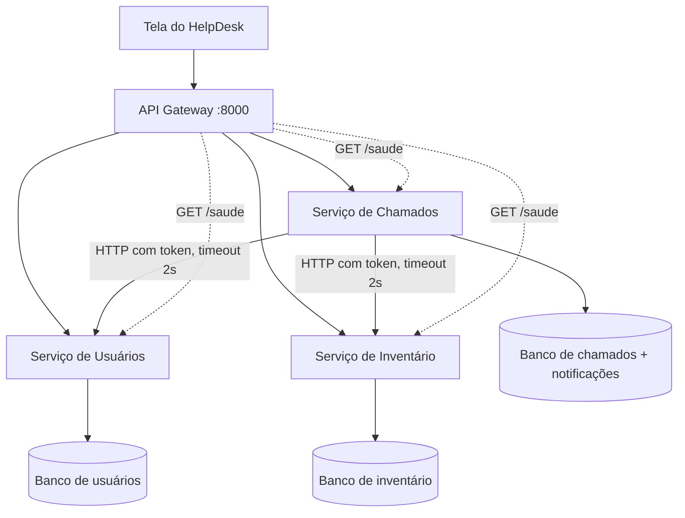

# HelpDesk TI · microsserviços

> **Vídeo de demonstração (4–6 min):** `[COLOQUE AQUI O LINK DO YOUTUBE (não listado) OU DO GOOGLE DRIVE]`
>
> Roteiro pronto no final deste README.

Sistema de chamados de TI (estilo GLPI simplificado) em **Python + FastAPI**.
O projeto original era um monólito; agora ele está separado em **três serviços independentes**,
cada um com o seu banco, mais um **API Gateway** que é o único ponto de entrada na porta **8000**.
A tela e todas as funcionalidades continuam iguais — só a arquitetura mudou.

## Arquitetura



Opcional (bônus) não implementado: fila de eventos + serviço de Notificações separado.
As notificações continuam funcionando, gravadas no banco do serviço de Chamados — isso evita
mais uma infraestrutura e mantém os chamados funcionando mesmo se algo relacionado a avisos falhar.

### Estrutura

```
gateway/                  API Gateway + tela (index.html, app.js, estilo.css)
servicos/usuarios/        login, JWT, cadastro de usuários  → usuarios.db
servicos/inventario/      equipamentos de TI                → inventario.db
servicos/chamados/        chamados, SLA, comentários e notificações → chamados.db
tests/                    teste da tela
```

Cada serviço tem o seu próprio `Dockerfile`, `requirements.txt`, pacote Python e testes.
Qualquer um pode ser iniciado sozinho (`uvicorn usuarios.main:app`, por exemplo).

## Como rodar

```bash
docker compose up --build
docker compose ps
```

Abra **http://localhost:8000**. O gateway serve a tela e encaminha:

| Rota | Serviço |
|---|---|
| `/auth/login`, `/auth/eu`, `/usuarios` | Usuários |
| `/ativos` | Inventário |
| `/chamados`, `/notificacoes` | Chamados |

Copie `.env.example` para `.env` para trocar o `JWT_SEGREDO` (use o mesmo valor para todos os serviços).
Sem `.env`, o Compose usa um segredo de desenvolvimento — nunca use essa configuração em produção.

**Sem Docker** (Python 3.11+), em quatro terminais, com `JWT_SEGREDO` compartilhado:

```bash
# em servicos/usuarios
DATABASE_URL=sqlite:///./usuarios.db uvicorn usuarios.main:app --port 8001
# em servicos/inventario
DATABASE_URL=sqlite:///./inventario.db uvicorn inventario.main:app --port 8002
# em servicos/chamados
DATABASE_URL=sqlite:///./chamados.db USUARIOS_URL=http://localhost:8001 \
  INVENTARIO_URL=http://localhost:8002 uvicorn chamados.main:app --port 8003
# em gateway
USUARIOS_URL=http://localhost:8001 INVENTARIO_URL=http://localhost:8002 \
  CHAMADOS_URL=http://localhost:8003 uvicorn gateway.main:app --port 8000
```

### Contas de acesso

Senha para todas: **`Helpdesk2026`** (configurável por `SENHA_EXEMPLO`).

| E-mail | Perfil |
|---|---|
| `admin@empresa.com` | Administrador |
| `carla@empresa.com`, `diego@empresa.com` | Técnicos |
| `ana@empresa.com`, `bruno@empresa.com` | Solicitantes |

Use **Carla** para o fluxo completo e **Ana** para conferir as permissões.
Os dados de exemplo são criados por cada serviço no seu próprio banco, apenas na primeira subida (`DADOS_EXEMPLO=1`).

## Funcionalidades

Abrir chamado com SLA (crítica 4 h, alta 8 h, média 24 h, baixa 72 h), atribuir técnico,
mudar status (`aberto → em_atendimento → resolvido → fechado`, com reabertura permitida),
comentar, ver o painel e receber notificações. As mesmas regras de permissão do monólito valem:
solicitante vê só os próprios chamados, só técnicos/admin atribuem e resolvem, só admin cria usuários.

## Segurança

- `/auth/login` é o único lugar que emite tokens; **todos os serviços validam o JWT** antes de responder.
- Os serviços de Inventário e Chamados validam assinatura, prazo, emissor e perfil **localmente**,
  sem ler o banco de usuários. O login confere também se o usuário está ativo no banco dele.
- Ao chamar outro serviço, o Chamados **repassa o `Authorization`** do usuário.
- Só o gateway publica porta; serviços e bancos ficam apenas na rede interna do Docker.
- Segredo `JWT_SEGREDO` vem do `.env`/ambiente; os contêineres rodam como usuário sem privilégios,
  com sistema de arquivos somente leitura e sem capacidades extras.

Detalhes em [SECURITY.md](SECURITY.md).

## Decisões tomadas

1. **Banco por serviço:** cada SQLite é um volume separado. As FK entre serviços foram removidas;
   `solicitante_id`, `tecnico_id`, `ativo_id` e `autor_id` são só inteiros. A existência do técnico
   e do equipamento é conferida pela rede no momento da operação.
2. **HTTP com timeout e falha clara:** Chamados usa `httpx` com timeout de 2 s. Se Usuários ou
   Inventário estiver fora, responde `503` com mensagem explicando qual serviço falhou, sem travar.
   O gateway espera 5 s (`GATEWAY_TIMEOUT_SEGUNDOS`) para conseguir repassar essa mensagem.
3. **Token compartilhado, banco não compartilhado:** o JWT é assinado com o mesmo segredo e
   carrega o perfil. Assim cada serviço aplica as permissões sem depender do banco dos outros.
   Um usuário desativado é barrado no próprio serviço de Usuários.
4. **Gateway fino:** FastAPI + `httpx` repassando método, corpo, query e cabeçalhos. A tela continua
   com `API = ""` (mesma origem), então nenhuma URL precisou mudar. `GET /saude` do gateway mostra
   quais serviços estão no ar.
5. **Notificações no serviço de Chamados:** são geradas pelas mesmas regras de antes e ficam no banco
   dos chamados. Fila de eventos e um serviço de Notificações separado ficaram como bônus opcional.
6. **Cada serviço sobe sozinho:** o *seed* de cada um é local; o Chamados não precisa que os outros
   estejam prontos para iniciar (usa apenas os ids conhecidos dos exemplos).

## Testes

```bash
pip install -r requirements-dev.txt
pytest -q
```

São **39 testes**, separados por serviço (`servicos/<servico>/tests/`): regras de negócio,
permissões, token inválido/vencido/sem assinatura, campos extras, limites de tamanho,
comunicação HTTP com token repassado e simulação de serviço fora do ar (503).
O GitHub Actions roda a suíte e o `pip-audit` a cada envio.

## Roteiro do vídeo (4–6 min)

1. Mostre o diagrama acima e explique os serviços, o gateway e os bancos.
2. `docker compose up --build` e `docker compose ps`.
3. Pela tela, entre como **carla@empresa.com**, abra um chamado com equipamento, atribua,
   resolva e feche. Repare que a URL continua `localhost:8000`.
4. `curl -i http://localhost:8000/chamados` (sem token) → **401**; entre como Ana e tente ver
   o chamado da Carla → **404**.
5. Mostre os três volumes/bancos (`docker volume ls` e os arquivos em cada volume).
6. `docker compose stop inventario`: lista de usuários e chamados continua; abrir chamado com
   equipamento mostra **503 com mensagem clara**. Depois `docker compose start inventario`.
7. Explique o que mudou: deploy independente e isolamento de banco melhoraram; a rede, o timeout
   e a consistência entre serviços são novos desafios.
